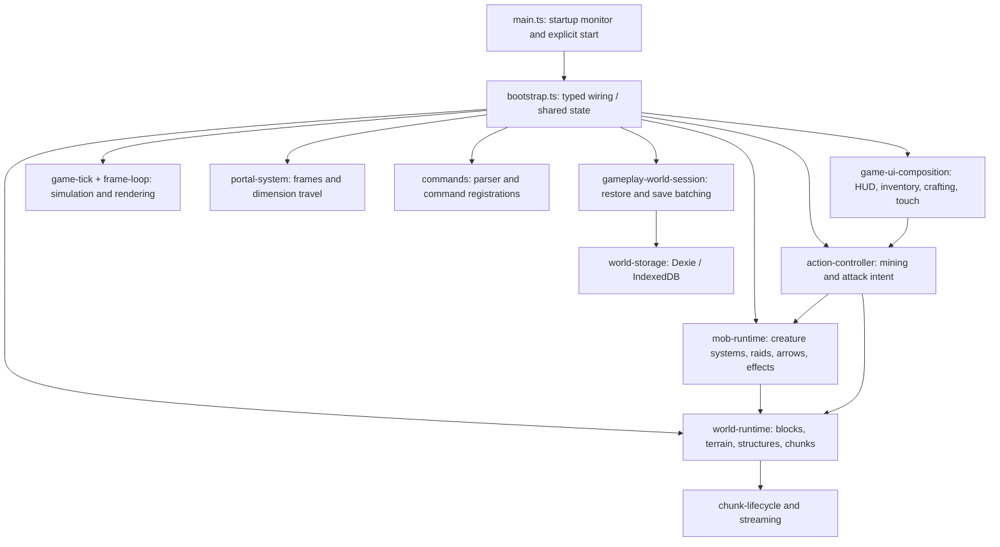
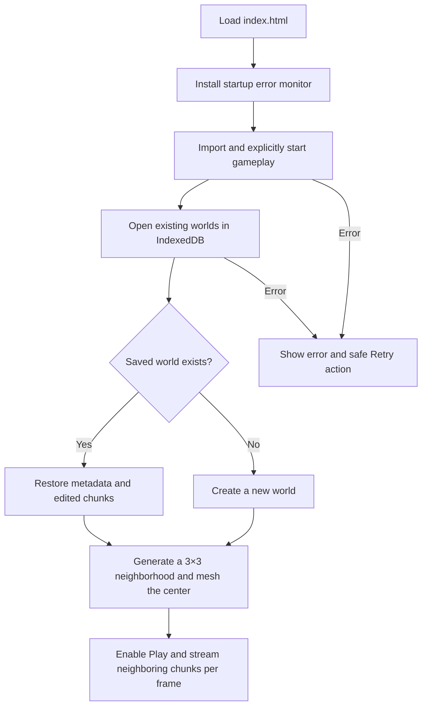

# MauriceCraft architecture

MauriceCraft is a plain TypeScript, Three.js and Vite game. You do **not** need React or a framework to add features. Every major subsystem should live in a small, named file so Maurice can find and understand it.

## Where do I make a change?

| Goal | Start here |
| --- | --- |
| New blocks, items, mining properties | `src/game/world/block-catalog.ts` |
| Terrain, villages, structures, chunks | `src/game/world/world-runtime.ts`, `chunk-generator.ts`, `chunk-lifecycle.ts`, `chunk-streamer.ts` and `structure-regions.ts` |
| Creature definitions, combat, spawning, raids and projectiles | `src/game/entities/mob-catalog.ts`, `mob-runtime.ts`, `mob-spawning.ts`, `mob-simulation.ts`, `mob-world-cycle.ts`, `arrow-system.ts` |
| Portal lighting and Nether travel | `src/game/portals/` |
| Inventory, crafting, trading, health | `src/game/ui/game-ui-composition.ts`, `src/game/crafting/`, `src/game/items/tool-usage.ts`, `src/game/interactions/block-interactions.ts` |
| Keyboard, mouse, phone controls and cooldowns | `src/game/input/game-controls.ts` and `action-controller.ts` |
| Chat, autocomplete and commands | `src/game/commands/` |
| Weather, sky, meshes, active simulation and frame scheduling | `src/game/rendering/`, `src/game/runtime/game-tick.ts`, `frame-loop.ts`, `game-session-controls.ts` |
| Sounds and music | `src/game/audio/` |
| World saving, restoration, storage and autosaves | `src/game/session/gameplay-world-session.ts`, `world-restore.ts`, `world-persistence.ts`, `world-session.ts`; `src/game/storage/world-storage.ts` |
| Webpage and phone layout | `index.html`, `src/styles/global.css` |

`src/main.ts` imports the CSS, installs startup error monitoring, dynamically imports `src/game/bootstrap.ts`, and explicitly calls `startGameApplication()`. Importing the game no longer starts an IIFE or starts the animation loop by itself. `bootstrap.ts` is the integration/composition boundary, **not** the owner of new gameplay rules. Its state facade is shared with typed subsystems rather than copied into each component.

New features belong in focused, strictly **typed** modules with clear input/output interfaces. The same 500-effective-line ESLint limit applies to every production TypeScript file, including the bootstrap. Avoid `@ts-nocheck`, `any`, module-import side effects, and storing runtime state in arbitrary global variables.

## System map

## Startup and loading

The renderer and initialization can fail on some mobile devices. An error must show a meaningful message and a reload option, never a permanently disabled **Loading…** button. Only initially needed chunks are generated synchronously; the chunk streamer fills the rest within a per-frame work budget.

## Versioned world generation

Worlds made before the biome upgrade lack `generatorVersion` and use v1. Earlier biome saves remain at **v2**, while new worlds store **`generatorVersion: 3`** and full-range 32-bit seeds. The v2 biome maps, chunk generator, tree decorator, and lake/cascade planner are in `biomes.ts`, `chunk-generator-v2.ts`, `tree-decorator.ts` and `natural-features.ts`. V3 adds deterministic cave tunnels and ravines (`cave-carver.ts`), actual volcano cones and lava craters (`volcanoes.ts`), different tree palettes, bounded water/lava flow (`fluid-simulator.ts`, `fluid-blocks.ts`) and authentic natural-feature labels (`world-landmarks.ts`). They are all coordinate/seed driven. Fluid levels are stored as distinct block IDs without renumbering source water/lava. Legacy worlds keep their original generation; any future terrain changes must be version-gated, with unit and browser save-load tests.

## Never break world saves

The `blockcraft-worlds` IndexedDB database is **stored in the player's browser**. It uses Dexie over the original version-1 `worlds` and `chunks` stores, with the same keys and block IDs. The world session serializes writes and retries failed dirty chunk saves. Loading failures must never delete or replace a saved world.

- Do not change existing block IDs or chunk coordinate keys.
- Do not rename the database, delete data, or silently reset a schema.
- Preserve deterministic terrain generation for older seeds.
- Test both **new worlds** and **reloads of existing worlds** after changes.
- Do not overwrite a player's world just because IndexedDB is blocked or unavailable.

## Performance rules

The per-frame code runs roughly 60 times per second. Keep its work bounded. Chunk streaming uses a fixed generation/meshing budget; mob spatial buckets avoid repeated full-crowd scans; target raycasts avoid per-actor temporary arrays. Avoid quadratic loops (`O(n²)`) and unnecessary allocations in game loops. Use representative unit tests and browser profiling before claiming a performance problem has been eliminated.

See [Testing](TESTING.md) and [Start here](START_HERE.md) for the workflow.
