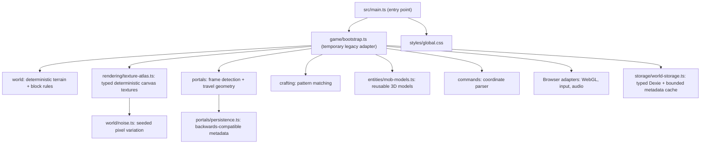
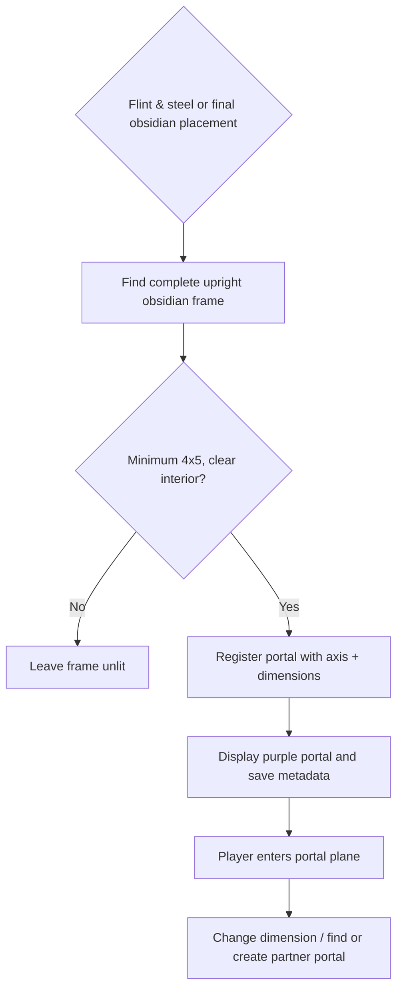

# Architecture

The former single-file `index.html` has been separated into an HTML shell, styles, an ES-module app entry, and game code. The refactor is intentionally incremental: existing behavior, deterministic terrain generation, block IDs, and IndexedDB saves must remain stable.

```text
index.html                       HTML shell and game UI
src/
  main.ts                        app entry (imports CSS and game bootstrap)
  styles/global.css              shared HUD, overlays, touch and responsive styles
  game/
    bootstrap.ts                  current gameplay loop and browser integration
    world/{noise,chunk-key,block-kind}.ts  deterministic world rules
    crafting/grid.ts              pure crafting pattern helpers
    entities/mob-models.ts         typed Three.js mob geometry factories
    commands/coordinates.ts       command coordinate parsing
    rendering/texture-atlas.ts    canvas textures for blocks, tools and items
```

## Responsibilities

- **World rules** belong in `game/world`; keep pure functions independent of the DOM and renderer.
- **Crafting/commands** own rules and parsing, not UI events.
- **Rendering/texture-atlas** owns the seeded block/item texture drawing independently of world state. The renderer passes in tool tile IDs.
- **Bootstrap** temporarily owns rendering, audio, UI events, entity behavior, and world generation. IndexedDB access is owned by the typed Dexie storage adapter. Extract each domain in focused, tested changes rather than large all-at-once migrations.
- **Styles** remain global while the HUD uses static element IDs. CSS Modules are appropriate once a UI element is extracted into its own component with isolated styling. Do not introduce React solely to use CSS Modules.

## Important compatibility rules

Existing users have saved worlds in the `blockcraft-worlds` IndexedDB database with `worlds` and `chunks` stores. `src/game/storage/world-storage.ts` uses **Dexie** on the unchanged version 1 stores, with atomic world/chunk transactions. It caches up to 16 metadata records; the existing gameplay chunk cache holds loaded chunk arrays instead of duplicating them in Dexie. Do not rename, reset, or silently migrate these. Any future schema change must include a tested upgrade path. Seeded noise and block IDs are also part of persisted world behavior.

`bootstrap.ts` currently has `// @ts-nocheck` because the legacy script is large and uses shared mutable state; new and extracted modules must be strictly typed. Removing that exception is a follow-up effort, not a pretext for rewriting working gameplay in one pass.

## Module boundaries



## Portal lighting and travel



### Mob models

`src/game/entities/mob-models.ts` owns the shared Three.js geometry/material factories and each mob's 3D shape. It does **not** own mob AI, spawning, combat, world state, or the render loop. That separation lets tests instantiate models without launching the game; future mob-behavior extraction can happen independently.

### Item and block identities

`src/game/world/block-catalog.ts` is the single source for historically assigned item IDs, mining timings, texture tile numbers and tool tiers. These IDs are embedded in saved-world data. When adding a block, choose a new ID and add a regression test; never reorder or reuse an existing ID.
