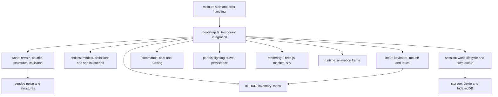
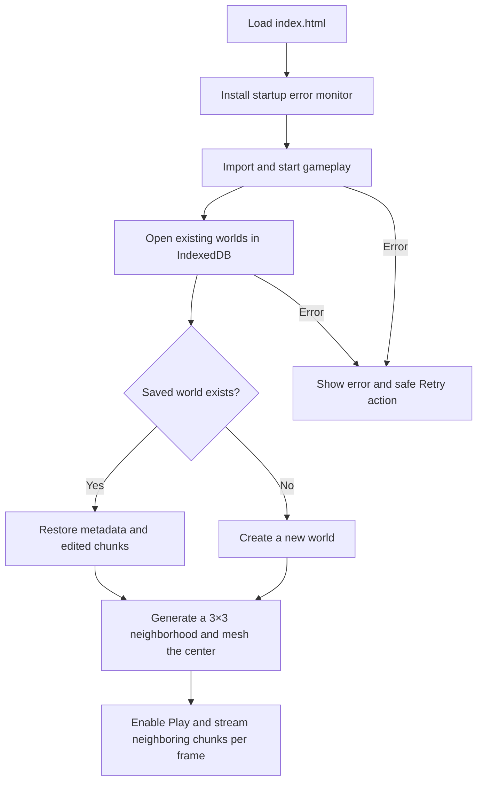

# MauriceCraft architecture

MauriceCraft is a plain TypeScript, Three.js and Vite game. You do **not** need React or a framework to add features. Every major subsystem should live in a small, named file so Maurice can find and understand it.

## Where do I make a change?

| Goal | Start here |
| --- | --- |
| New blocks, items, mining properties | `src/game/world/block-catalog.ts` |
| Terrain, villages, structures, chunks | `src/game/world/` |
| Mob appearances and species statistics | `src/game/entities/mob-models.ts` and `mob-catalog.ts` |
| Portal lighting and Nether travel | `src/game/portals/` |
| Inventory, crafting, trading, health | `src/game/ui/` and `src/game/crafting/` |
| Keyboard, mouse, phone controls | `src/game/input/game-controls.ts` |
| Chat, autocomplete and commands | `src/game/commands/` |
| Weather, sky, meshes, frame rendering | `src/game/rendering/` and `src/game/runtime/` |
| Sounds and music | `src/game/audio/` |
| World saving and loading | `src/game/session/world-session.ts` and `src/game/storage/world-storage.ts` |
| Webpage and phone layout | `index.html`, `src/styles/global.css` |

`src/main.ts` imports the CSS, monitors startup errors and launches the game module. `src/game/bootstrap.ts` remains a **temporary wiring adapter** for game systems and some unfinished gameplay extraction. It uses standard ES-module scope: the old immediately invoked function expression (IIFE) has been removed.

New features belong in focused, **typed** modules with clear input/output interfaces, not new blocks of code in `bootstrap.ts`. Keep production TypeScript modules within the 500-line lint limit. The bootstrap's current `@ts-nocheck` exception must be removed once its remaining untyped gameplay is migrated; do not copy that exception into new files.

## System map

## Startup and loading

The renderer and initialization can fail on some mobile devices. An error must show a meaningful message and a reload option, never a permanently disabled **Loading…** button. Only initially needed chunks are generated synchronously; the chunk streamer fills the rest within a per-frame work budget.

## Versioned world generation

Worlds created before the biome upgrade have no `generatorVersion` and use generator v1. Newly created worlds explicitly store `generatorVersion: 2` and use full-range 32-bit seeds. Loading and portal travel preserve the selected version, so edits and unexplored terrain in older worlds do not unexpectedly change. Do not modify v1 terrain/structures in place; new algorithms belong behind version 2.

## Never break world saves

The `blockcraft-worlds` IndexedDB database is **stored in the player's browser**. It uses Dexie over the original version-1 `worlds` and `chunks` stores, with the same keys and block IDs. The world session serializes writes and retries failed dirty chunk saves. Loading failures must never delete or replace a saved world.

- Do not change existing block IDs or chunk coordinate keys.
- Do not rename the database, delete data, or silently reset a schema.
- Preserve deterministic terrain generation for older seeds.
- Test both **new worlds** and **reloads of existing worlds** after changes.
- Do not overwrite a player's world just because IndexedDB is blocked or unavailable.

## Performance rules

The per-frame code runs roughly 60 times per second. Keep its work bounded. Chunk streaming uses a fixed generation/meshing budget; mob spatial buckets avoid repeated full-crowd scans; target raycasts avoid per-actor temporary arrays. Avoid quadratic loops (`O(n²)`) and unnecessary allocations in game loops. Use representative unit tests and browser profiling before claiming a performance problem has been eliminated.

See [Testing](TESTING.md) and [Start here](START_HERE.md) for the workflow.
