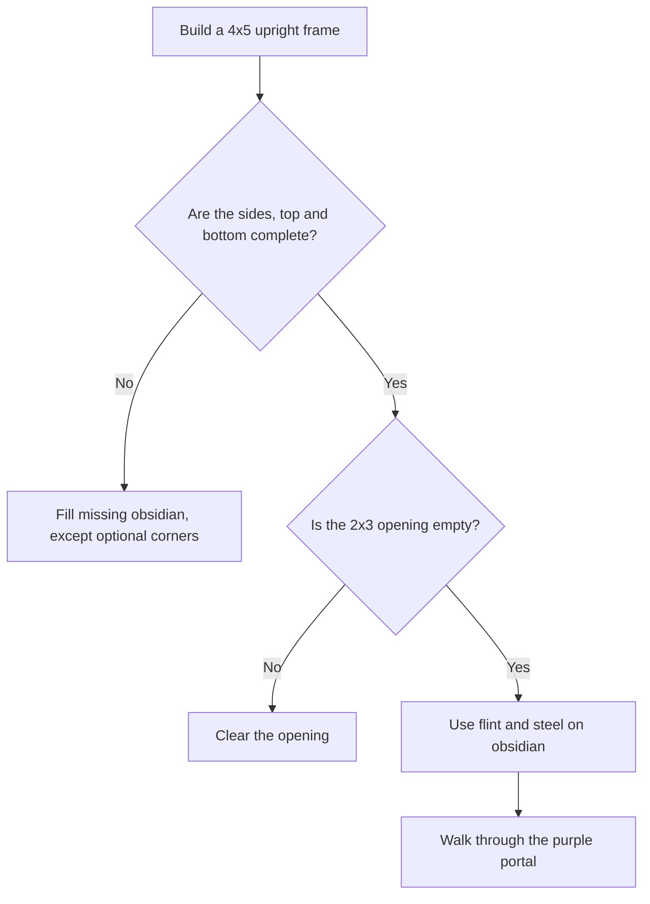

# Building and lighting a Nether portal

This guide is for players, especially anyone building their first portal.

## The smallest valid frame

Make a **vertical** obsidian frame that is four blocks wide and five blocks tall. Its opening is **two blocks wide and three blocks tall**. The four corners are optional, so you only need **10 obsidian blocks**.

```text
  . O O .     O = obsidian
  O . . O     . = empty space
  O . . O
  O . . O     The four corner dots may also be O.
  . O O .
```

You can build the frame facing either direction (along X or along Z). Don't fill the opening with dirt, glass, or other blocks.

## Turn it on

1. Hold flint and steel, which is listed in the inventory as **Flint & Steel**.
2. Aim at one of the obsidian blocks of the completed frame and use the item.
3. Look for a purple doorway and walk through it to enter the Nether.
4. Walk through the matching portal to return to the Overworld.

The game also supports older full 5×5 frames. In Creative mode, the `/portal build` command builds a frame for you as a shortcut; you can walk through it immediately. Portals do not operate in the End.

## If the portal doesn't light

Check the two sides and the top/bottom for missing obsidian blocks. The opening must be completely empty. Try aiming directly at obsidian with flint and steel rather than TNT. On phones, use the on-screen action controls.

If something still fails, ask a coding helper to use the [fix-a-bug skill](../.github/skills/fix-a-bug/SKILL.md). The frame logic is in `src/game/portals/frame.ts`, and regression tests are in `tests/unit/portals.test.ts`.


