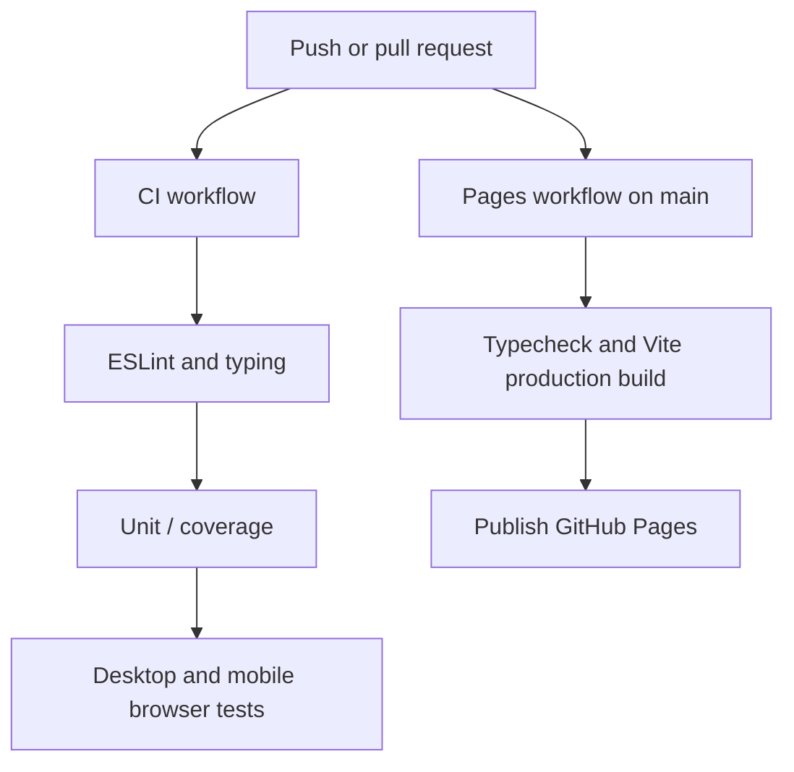

# Testing MauriceCraft

Treat existing saved worlds and mobile controls as important game features. Write regression tests for every bug before calling it fixed.

## Run tests on your computer

```sh
npm ci
npm run check
npx playwright install chromium
npm run test:e2e
```

`npm run check` runs ESLint, TypeScript, Vitest with coverage, and a production Vite build. `npm run check:full` also runs Playwright. During development, `npm run test:watch` reruns Vitest automatically.

## What each test protects

| Type | Location | Catches |
| --- | --- | --- |
| Unit / regression | `tests/unit/` | Terrain math, block IDs, recipes, mob targeting, chunk budgets, portal dimensions, storage logic |
| Browser integration | `tests/e2e/` | Play becoming enabled, game controls, menus, mobile touch, portal commands, saved data after reload |
| Type and style | `npm run typecheck`, `npm run lint` | Invalid interfaces, unsafe JavaScript, unnecessarily large TypeScript files |
| Production build | `npm run build` | Broken imports, Pages base path, TypeScript/build errors |

Browser tests run the **compiled production game**, not just isolated functions. They should cover real actions and the resulting world state whenever practical. The initial **Loading…** button must become Play or a visible recoverable error. Test both desktop and a touch/mobile browser. A fake phone-sized viewport is useful but does not prove every physical phone works, so manual device checks are also valuable.

## GitHub Actions

**CI and GitHub Pages are separate independent workflows.** A failing unit test must not block publishing a buildable website, but a failing TypeScript check or production build must stop Pages deployment.



Continuous integration should complete with **all checks green** on the final commit. Do not rely on a canceled older run, ignore failures, lower coverage thresholds, or bypass tests to get a green badge. GitHub Pages does not prove gameplay tests passed.

## When working on a bug

1. Reproduce the problem in the game.
2. Add a focused test that fails without the fix.
3. Fix the underlying cause in the responsible module.
4. Run unit tests, typing, lint, production build and appropriate browser scenarios.
5. Verify the game on a mobile browser when touch, WebGL, startup or world loading changes.
6. Explain what changed, how to try it, and which checks passed.

For Minecraft-like behavior that depends on saved data, use deterministic test worlds and inspect actual IndexedDB records instead of only checking UI success messages.
