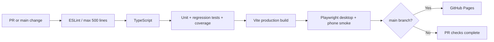

# Testing

Automated tests are added after the initial source hierarchy refactor so changes can be reviewed separately.

## Unit tests

`npm test` runs Vitest once. `npm run test:watch` reruns tests while editing and `npm run test:coverage` checks coverage of extracted pure gameplay rules.

The unit suite protects the saved-world chunk-key encoding, deterministic terrain noise, mining classification, crafting-grid pattern matching, and command coordinate parsing. When extracting more functions from `src/game/bootstrap.ts`, add tests in `tests/unit/` before altering behavior. The legacy bootstrap is not counted as unit-test coverage until it becomes testable.

## Browser tests

Playwright smoke tests will cover the compiled production app on desktop and a mobile viewport, including startup, menu navigation, and touch UI. The browser tests are intentionally smaller than full gameplay integration tests, which require additional deterministic fixtures.

## Before changing game rules

Run the relevant unit tests, then the entire test suite and production build. Test world-save compatibility and a phone-size viewport when changing storage, UI, or input. New gameplay changes should not depend solely on browser smoke tests.

## Shift-left quality gates

Use `npm run check` on every meaningful code change to enforce lint, typecheck, unit coverage and a production build. After `npx playwright install chromium`, run `npm run check:full` for the full production-browser suite. The separate **CI** workflow runs lint, TypeScript, coverage, build and browser checks on pushes and pull requests. **Deploy GitHub Pages** is independent: it installs dependencies, typechecks, builds and publishes the site from main without waiting for unit or browser tests. A TypeScript/build failure still prevents deployment.

The line-count limit applies to non-test TypeScript, with the original bootstrap temporarily excluded from lint. Browser smoke and pure unit tests are complementary: regression tests cover frame lighting and save metadata, while browser smoke detects startup, mobile input and portal-command failures.

The automated coverage gate includes world rules, commands, crafting, **portal frame/save compatibility**, and **Dexie storage**. Browser-dependent modules (WebGL, Web Audio, and the temporary legacy bootstrap) are exercised through separate integration and browser tests and will be added to coverage gates as they are made testable. Do not lower thresholds just to pass CI.
